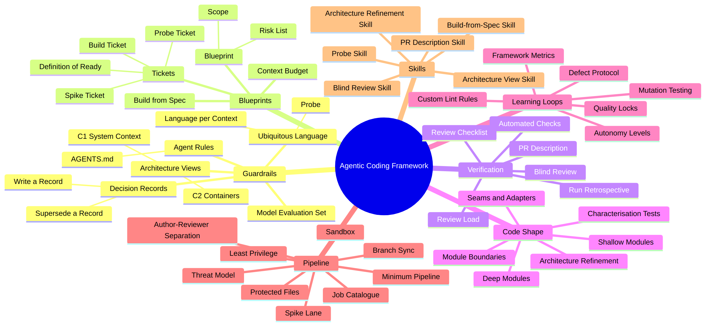

# Agentic Coding Framework (ACF)

**Guardrails, blueprints, and verification for reliable agent-written code.**

Coding agents write code very quickly. Speed alone does not give value. When an agent receives a vague task, it produces a large diff that nobody can trust. The team then spends more time on repair than the agent saved.

The Agentic Coding Framework (ACF) changes this result. It treats an agent like a fast new team member who needs a clear structure. The agent gets precise work and strict guardrails. Agents draft language, decisions, and architecture views with evidence. People keep three responsibilities: the strategy, confirmation of meaning and decisions, and the final approval.



## The main principle

**Guardrails first. Throughput second.**

Guardrails are all mechanisms that keep quality high: a shared ubiquitous language, written decisions, automated checks, independent review, and human approval. Throughput is all that lets work continue without a person present: triggers, schedules, sandboxes, and parallel agents.

If you increase throughput before the guardrails operate, you only produce defects more quickly. If you install the guardrails first, you can increase throughput safely.

## The ACF cycle

All work in the framework goes through the same five stages:

| Stage | Question | Main output |
| --- | --- | --- |
| 1. Define | Do people and agents use the same words and decisions? | Agent-drafted language, decision records, C1/C2 views (people confirm meaning and approve) |
| 2. Blueprint | Is the work small and clear enough for one agent session? | A blueprint and ready tickets |
| 3. Build | Did the agent implement exactly the ticket? | A pull request |
| 4. Verify | Is the change correct, safe, and in agreement with the guardrails? | Check results, blind review, human decision |
| 5. Learn | Which one improvement prevents the next error? | A new rule, check, or template |

The Learn stage is the source of long-term value. Each cycle makes the guardrails stronger. Thus, the next cycle needs less human attention.

## Contents

- [Part 0 – Key terms](acf/guide/00-key-terms.md): every term with a definition and an example
- [Part 1 – Set up](acf/guide/01-set-up.md): the agent environment and the guardrail files
- [Part 2 – Shared meaning](acf/guide/02-shared-meaning.md): ubiquitous language, probe sessions, decision records, C1/C2 views
- [Part 3 – Blueprints](acf/guide/03-blueprints.md): plan work that is larger than one session
- [Part 4 – Verification](acf/guide/04-verification.md): automated checks, blind review, human approval
- [Part 5 – Code shape](acf/guide/05-code-shape.md): code that agents can change safely
- [Part 6 – Learning loops](acf/guide/06-learning-loops.md): make types of error impossible
- [Part 7 – The pipeline](acf/guide/07-pipeline.md): minimum pipeline, threat model, metrics, autonomy levels
- [Part 8 – Case studies](acf/guide/08-case-studies.md): a legacy billing service and a new subscription service

Filled samples: [examples/billing-service](examples/billing-service/), [examples/subscription-service](examples/subscription-service/).

## Install

Run this in the root of your project:

```bash
curl -fsSL https://raw.githubusercontent.com/Gabrielx23/agentic-coding-framework/main/install.sh | sh
```

The installer adds `acf/` (framework), creates the missing parts of `acf-project/` (never overwrites your files), and creates `AGENTS.md` if it does not exist. Run the same command again to upgrade.

Options: `--ref v0.1.0` (pin a version), `--dir <path>`, `--dry-run`, `--yes`.

To read the script before you run it:

```bash
curl -fsSL https://raw.githubusercontent.com/Gabrielx23/agentic-coding-framework/main/install.sh -o install.sh
less install.sh
sh install.sh
```

## Quick start

After Install, or after you copy the drop-in packages by hand:

1. Copy the `acf/` directory into the project root, including [`acf/NOTICE.md`](acf/NOTICE.md).
2. Copy the `acf-project/` directory into the project root (empty skeleton plus charter and metrics templates).
3. Copy root [`AGENTS.md`](AGENTS.md) into the project root. Keep the pointer to `acf/AGENTS.md`. Edit only **Project overrides**.
4. Fill [`acf-project/ACF_CHARTER.md`](acf-project/ACF_CHARTER.md) and [`acf-project/metrics.md`](acf-project/metrics.md).
5. Ask an agent to draft the first ubiquitous language with the [probe skill](acf/skills/probe.md). Give initial input if you want to. Confirm meaning. Do not merge unconfirmed terms.
6. Ask an agent to draft the first decision records with the [decision-record skill](acf/skills/decision-record.md). Status stays `Proposed` until a named person accepts.
7. Ask an agent to draft the C1 and C2 views with the [architecture view skill](acf/skills/architecture-view.md). Confirm every unconfirmed element.
8. Write your first ticket with the [build ticket template](acf/templates/build-ticket.md).
9. Check the ticket against the [Definition of Ready](acf/templates/definition-of-ready.md).
10. Run the minimum pipeline: ready ticket → build → automated checks → [blind review](acf/skills/blind-review.md) → human decision.

**Agents draft language, decision records, and architecture views.** A person must confirm meaning and decisions, not only correct mistakes. Drafts are pull requests. They go through blind review like code.

**Root `AGENTS.md` must point to `acf/AGENTS.md`.** The root file also holds non-negotiable rules for tools that load only the root file. If your tool uses `CLAUDE.md`, `.github/copilot-instructions.md`, or Cursor rules, that file must point to root `AGENTS.md`.

ACF works with any language and stack. The guardrails are plain Markdown files. Only the enforcement (linters, boundary rules, mutation testing) uses your own toolchain.

## Directory layout

In a project that uses ACF, the files look like this:

```
project-root/
├── AGENTS.md                 # non-negotiable rules + pointer + overrides
├── CODING_STANDARDS.md       # short, tools enforce most rules (project-owned)
├── acf/                      # framework only — replace on upgrade
│   ├── AGENTS.md
│   ├── NOTICE.md
│   ├── VERSION
│   ├── guide/
│   ├── skills/
│   └── templates/
├── acf-project/              # project-owned — never replace on upgrade
│   ├── ACF_CHARTER.md
│   ├── metrics.md
│   ├── ubiquitous-language/  # example: billing.md (start empty)
│   ├── adr/                  # example: ADR-001-….md (start empty)
│   ├── architecture/
│   ├── evaluation-set/
│   ├── blueprints/           # example: 2026-10-partial-refunds.md
│   └── retrospectives/       # example: 2026-10-15.md
└── src/
```

Example file names in this diagram are examples only. The shipped `acf-project/` skeleton starts empty (except charter and metrics starters). See [Part 1 – Set up](acf/guide/01-set-up.md).

## Upgrade

1. Read [CHANGELOG.md](CHANGELOG.md) for the new version.
2. Replace the `acf/` directory with the new framework package. Keep [`acf/NOTICE.md`](acf/NOTICE.md) and record your changes in it.
3. Do not touch `acf-project/`. Your language files, decision records, architecture views, charter, metrics, blueprints, retrospectives, and evaluation set stay in place.
4. Compare root `AGENTS.md` with the new example. Merge any new non-negotiable rules. Keep your project overrides.

## What needs tooling

Markdown alone does not enforce the framework. You must add these mechanisms:

| Mechanism | What enforces it | Guide |
| --- | --- | --- |
| Blind review with a second model | Separate review job or model | [Part 4](acf/guide/04-verification.md) |
| Mutation testing | CI job | [Part 4](acf/guide/04-verification.md) |
| Architecture drift check | CI script vs C2 view | [Part 2](acf/guide/02-shared-meaning.md), [Part 7](acf/guide/07-pipeline.md) |
| Protected-file rules | Branch protection or CODEOWNERS | [Part 7](acf/guide/07-pipeline.md), [examples/ci/CODEOWNERS](examples/ci/CODEOWNERS) |
| Metrics | Weekly process plus CI or spreadsheet | [Part 7](acf/guide/07-pipeline.md) |

## Repository structure

```
├── AGENTS.md       root pointer + non-negotiable rules (copy into projects)
├── CHANGELOG.md
├── CONTRIBUTING.md
├── assets/         framework map
├── acf/            framework package (guide, skills, templates, NOTICE, VERSION)
├── acf-project/    project-owned skeleton (copy into projects; never replace on upgrade)
└── examples/       billing-service, subscription-service, ci
```

Skills for Define work: [probe](acf/skills/probe.md), [decision-record](acf/skills/decision-record.md), [architecture view](acf/skills/architecture-view.md).

Download the full guide as a PDF from the [latest release](https://github.com/Gabrielx23/agentic-coding-framework/releases/latest).

## Acknowledgements

ACF builds on established engineering practice: ubiquitous language and bounded contexts from Domain-Driven Design (Eric Evans), the C4 model (Simon Brown), Architecture Decision Records (Michael Nygard), deep modules (John Ousterhout), and characterisation tests and seams (Michael Feathers).

## License

© 2026 Gabriel Slawski.

This work is licensed under [CC BY 4.0](LICENSE). You can copy, adapt, and use it for any purpose, also commercially, if you give appropriate credit.

**How to give credit:** keep the author's name, link to this repository and to the license, and say if you made changes. For example:

> Based on the [Agentic Coding Framework](https://github.com/Gabrielx23/agentic-coding-framework) by Gabriel Slawski, licensed under [CC BY 4.0](https://creativecommons.org/licenses/by/4.0/). Changes: …
