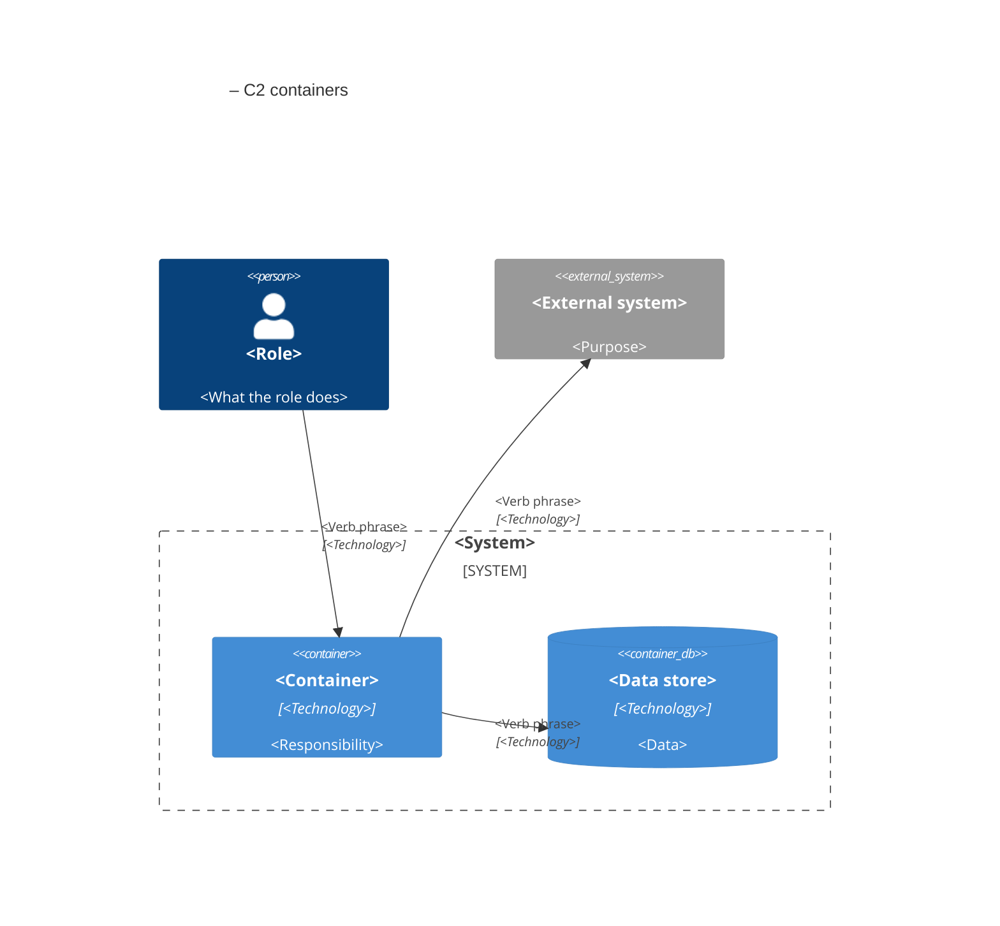

# Part 2 – Shared meaning

## Chapter 3 – Ubiquitous language

An agent does not know your business. It knows only the words in the ticket, the conversation, and the code. If one word has two meanings, the agent mixes the two concepts. If two words have one meaning, the agent invents two concepts.

A shared ubiquitous language prevents both errors. The term comes from Domain-Driven Design: one language that people, agents, tickets, and code all use. It is the first and strongest guardrail.

### What belongs in the ubiquitous language

The ubiquitous language contains domain terms only. A domain term has a specific business meaning in one bounded context, for example Invoice, Refund, or Plan. Technical words, for example function, queue, or retry, are not domain terms.

This limit is important. AGENTS.md tells the agent to stop when a domain term is missing. If this rule applies to each technical word, the agent stops all the time. Then people ignore the rule.

### Draft the first ubiquitous language

An agent can draft what the code suggests. It cannot know what the business means. Drafting from code is a first step only. The probe then interviews a person about every unconfirmed item. A named domain expert must confirm meaning. Correction of typos alone is not enough.

1. Name one bounded context, for example billing.
2. Run the [probe skill](../skills/probe.md) (and optional seed notes from a person).
3. The agent lists the 8 to 15 most important nouns and verbs, then fills each entry:
   - What is this concept exactly?
   - What is it not?
   - Which rules and states apply to it?
   - What is the evidence (file path, ticket, document, or `person: <name>`)?
4. Mark every item without evidence `unconfirmed` and ask a person.
5. The agent opens a pull request with `acf-project/ubiquitous-language/<context>.md`. The draft must go through blind review.
6. A named domain expert confirms meaning, records Approver in the file, and merges.

Entry template:

```markdown
## TermName

Definition: one sentence.
Rules and states: the exact rules that apply.
Not to be confused with: related terms.
Prohibited synonyms: words that must not replace this term.
Evidence: <file path | ticket | document | person: name>
Status: confirmed | unconfirmed
```

Example from a billing context:

```markdown
## Invoice

Definition: A formal request for payment to a Customer for one or more LineItems.
Rules and states:
- Status: draft, issued, paid, void, or refunded.
- You can edit a draft Invoice.
- You cannot change the LineItems of an issued Invoice.
- Only an issued Invoice can change to paid or void.
- Only a paid Invoice can receive a Refund.
- A paid Invoice changes to refunded when its RemainingBalance is zero.
Not to be confused with: Payment, Refund.
Prohibited synonyms: bill, receipt, statement.

## LineItem

Definition: One row on an Invoice that has a price.
Rules and states:
- A LineItem has quantity, unitPrice, and taxRate.
- Its total is always quantity × unitPrice × (1 + taxRate).
Prohibited synonyms: product, item.
```

When an agent needs a new domain word, it drafts an entry (often through a probe ticket) and opens a pull request. A named domain expert must confirm meaning before agents treat the term as accepted. After some weeks, the ubiquitous language becomes the only source of truth for the language of the domain. See also [examples/billing-service](../../examples/billing-service/).

## Chapter 4 – Probe sessions

Ambiguity is expensive. It is less expensive to find it in a conversation than in a pull request. A probe session is a structured interview that removes ambiguity from one definition or one decision.

### Rules of a probe session

- Ask one question at a time.
- Each question examines one of five targets: a boundary, an edge case, a state change, a prohibited synonym, or a conflict with an existing rule.
- After each answer, update the written definition.
- Stop when new questions do not change the definition.

The fifth target, conflict with an existing rule, finds the most valuable defects. Two rules that are correct alone can be in conflict when they are used together.

### Probe skill

Give this instruction to the agent:

```text
You are a probe interviewer. Your goal is one precise definition.
Ask one question at a time.
Each question examines a boundary, an edge case, a state change,
a prohibited synonym, or a conflict with an existing rule.
After each answer, show the updated definition.
Stop when a new question does not change the definition.
Then give the final text for the language file.
```

### Example

> **Agent:** What occurs when a Customer pays only part of an Invoice?
>
> **You:** The system rejects partial payments. The Invoice stays issued until the full amount arrives.
>
> **Agent:** Updated: an issued Invoice changes to paid only after full payment. Can a paid Invoice change back to issued?
>
> **You:** No.
>
> **Agent:** Conflict check: partial payments are not possible, so an issued Invoice has no collected money. Can a Refund apply to an issued Invoice?
>
> **You:** No. A Refund applies only to a paid Invoice.
>
> **Agent:** After a full refund, the Customer has no payment left. Is "paid" still the correct status?
>
> **You:** No. Add a new status: refunded.

The last two questions found a conflict before anyone wrote code. The agent opens a pull request with the final definition. A person reviews and merges.

## Chapter 5 – Decision records and architecture views

A decision record (ADR) is a short document about one important design decision. Without written decisions, each new agent session examines the same alternatives again. Often, it selects an alternative that the team rejected before. A decision record makes the decision permanent and visible.

### Record template

```markdown
# ADR-XXX: Short title

## Status
Proposed | Accepted | Superseded by ADR-YYY

## Context
The problem and the important facts only.

## Decision
The exact decision. A new reader can apply it without more explanation.

## Alternatives rejected
Each alternative and the reason for the rejection.

## Consequences
What becomes easier. What becomes more difficult. New rules.
```

The section "Alternatives rejected" is important for agents. It tells the agent which ideas it must not propose again.

An agent drafts each record with the [decision-record skill](../skills/decision-record.md). Status must be `Proposed`. Context and Alternatives rejected must say "To be confirmed by a person" unless a person gave that information. Each fact must show evidence. Items without evidence stay `unconfirmed`. The draft must go through blind review. Only a named person can set Status to `Accepted` on merge.

### Example

```markdown
# ADR-004: Explicit status field on Invoice

## Status
Accepted

## Context
The code calculated the Invoice status from payment records and void flags.
This calculation caused race conditions and slow queries.

## Decision
Each Invoice has one status column: draft, issued, paid, void, refunded.
One pure function validates all status changes.
No other table stores a copy of the status.

## Alternatives rejected
- Calculated status in a database view: still slow, and it hides the transition rules.

## Consequences
Status queries become simple and you can index them.
All status changes go through the transition function.
Remove the code that calculates the status.
```

The agent puts each proposed record in `acf-project/adr/` in a pull request. A named person confirms the decision and sets Status to `Accepted` on merge. Each ticket lists the records that apply to it (Chapter 6). When a decision changes, the agent writes a new record and supersedes the old one.

### Exercise: test a decision record

1. Select a decision in your codebase that is not obvious to a new developer.
2. Write the full record and commit it.
3. Start a new agent session with a ticket that lists the record.
4. Ask the agent for a design that is in conflict with the record.
5. Make sure that the agent refuses or gives a warning.
6. If the agent ignores the record, make the rule in AGENTS.md stronger. Do steps 3 to 5 again.

### Architecture views (C1 and C2)

Decision records explain why the system has its shape. Architecture views show the shape. An agent that cannot see the shape puts code in the wrong location or adds a dependency that nobody wants. The framework uses the first two levels of the C4 model:

| View | Shows | Question that the view answers for the agent |
| --- | --- | --- |
| C1 – System context | The system, its users, and the external systems | Which people and systems can my change affect? |
| C2 – Containers | The applications, services, and data stores inside the system, with their technology | Where does my change belong, and which containers must not change? |

Rules for architecture views:

- Keep each view as text (Mermaid or Structurizr DSL) in `acf-project/architecture/`. Text views have versions and diffs, like code.
- Use a maximum of 20 elements in one view. Divide a larger view.
- Write each relation as a verb phrase with its technology, for example "Sends orders [HTTPS]".
- Each build ticket lists the containers that the change touches. The agent receives the C2 view.
- A new container or a new external system needs a decision record. Update the C2 view in the same pull request.
- The views are protected files.

Do not keep C3 (component) or C4 (code) views by hand. The code and the enforced module boundaries (Chapter 8) give this level of detail, and they are always current.

### C2 template



### Build the views

The views describe the system that the agents change, not the ACF pipeline. An agent drafts both views with the [architecture view skill](../skills/architecture-view.md). Each element must show evidence. Items without evidence stay `unconfirmed`. The draft must go through blind review. A person must confirm unconfirmed elements before merge.

| System | When | How |
| --- | --- | --- |
| New system | Define stage, before the first build ticket | An agent drafts the C1 view from the product goal and any seed notes. The C2 view starts with the first containers and grows with each decision record. |
| Existing system | Week 0, together with the first guardrail files | An agent drafts both views from the repository. A person confirms or corrects each element. |

For an existing system, the agent finds the containers in the code: deployment files, entry points, database migrations, and API clients. It cannot find the purpose of a system or the role of a person. It marks those items "unconfirmed" and asks. A person answers or corrects in the pull request.

### Architecture view skill

```text
You write C4 architecture views: one C1 view and one C2 view.
Inputs: the repository, the deployment files, the decision records,
the language files, the existing views (if any), and any initial input from a person.
If a person gave initial input, treat it as a draft. Improve it. Do not ignore it.
Write each view as C4 Mermaid text under acf-project/architecture/.
For each element and relation, give the evidence: a file path, a ticket, a document,
a decision record, or person: <name>.
If you have no evidence, mark the element unconfirmed and ask a question.
Do not guess a technology. Write "?".
Use a maximum of 20 elements in one view.
Write each relation as a verb phrase with its technology.
If views exist, list each difference between the existing views and the code.
Open a pull request. The draft must go through blind review like code.
A person must confirm unconfirmed elements, then merge.
```

### Keep the views current

An incorrect view is more dangerous than no view, because agents trust it. Use three mechanisms:

1. **Same pull request:** A decision record that adds or removes a container or an external system updates the C2 view in the same pull request.
2. **Drift check:** A script in the automated checks compares the containers in the C2 view with the deployable units in the repository, for example Dockerfiles or deployment manifests. A difference fails the check. This check is a quality lock (Chapter 9).
3. **Scheduled update job:** The architecture view job runs the skill one time each month and opens a pull request with the differences (Chapter 11).

Case studies 1 and 2 show the C1 and C2 views of the systems that the agents build. Filled samples live in [examples/billing-service](../../examples/billing-service/) and [examples/subscription-service](../../examples/subscription-service/).

← [Part 1 – Set up](01-set-up.md) · [Contents](https://github.com/Gabrielx23/agentic-coding-framework#contents) · [Part 3 – Blueprints](03-blueprints.md) →

---

© 2026 Gabriel Slawski · [Agentic Coding Framework](https://github.com/Gabrielx23/agentic-coding-framework) · Licensed under [CC BY 4.0](https://creativecommons.org/licenses/by/4.0/)
