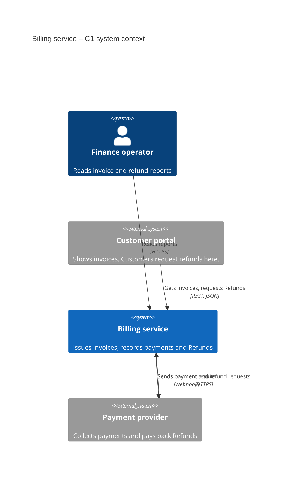
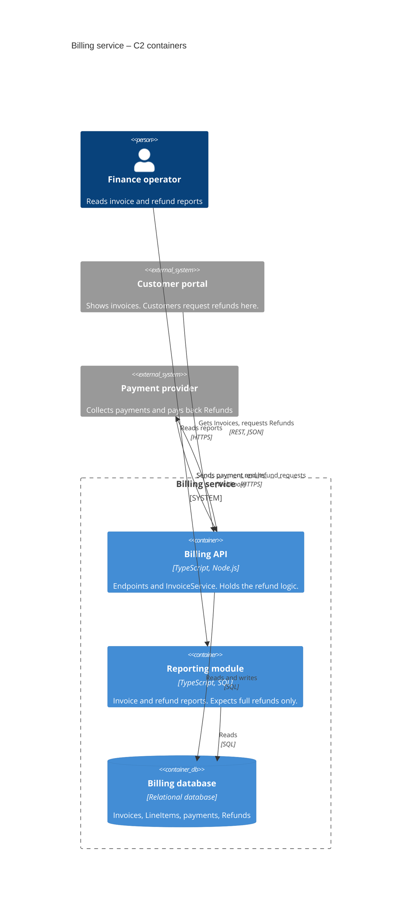
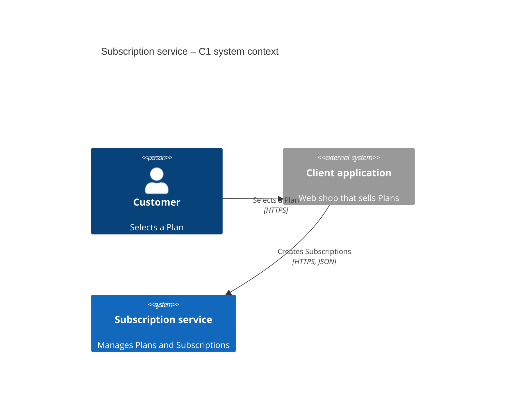
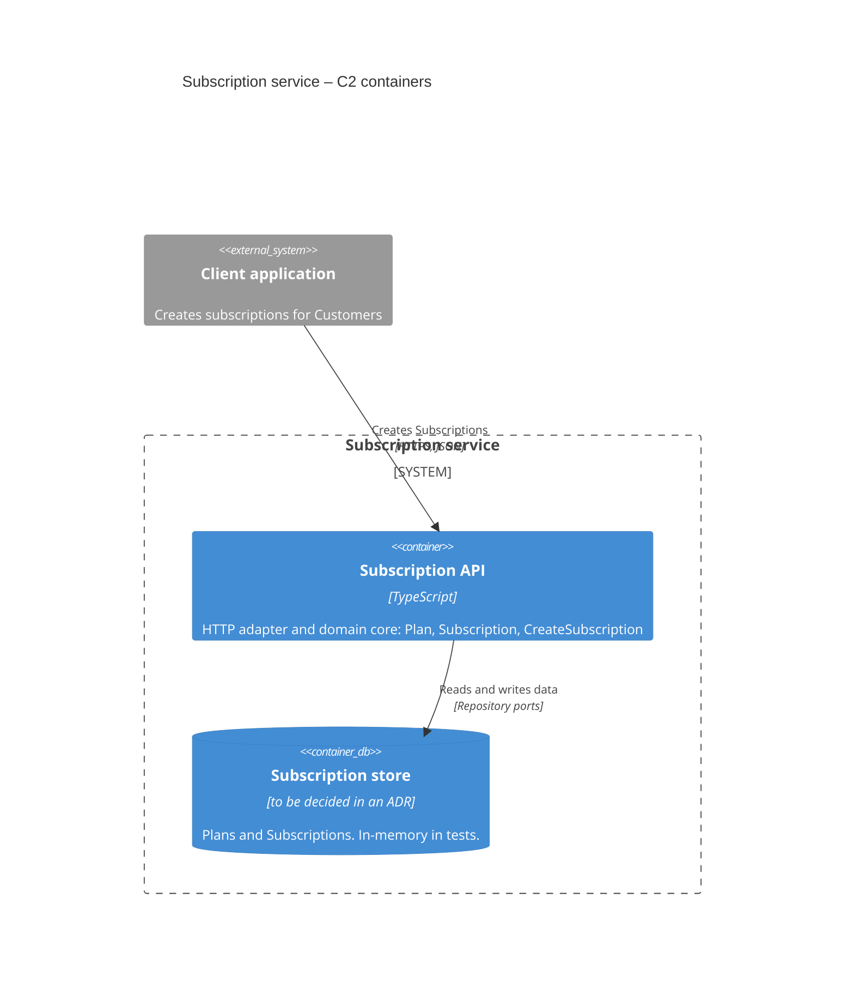

# Part 8 – Case studies

## Case study 1 – A legacy billing service

### Starting point

The system is a TypeScript service for invoices and payments. It has existed for some years. The names are not consistent, and the core domain has few tests. One large class, InvoiceService, has many responsibilities.

The goal of the first two weeks is not a rewrite. The goal is the minimum set of guardrails for one small, valuable change: partial refunds.

Filled sample files for this case study live in [examples/billing-service](../../examples/billing-service/).

### Two-week plan

| Period | ACF stage | Work |
| --- | --- | --- |
| Week 0 | Define | Copy `acf/`, `acf-project/`, and root AGENTS.md. Agents draft the first language file, decision record, and C1/C2 views. A person confirms meaning and merges. Do not change production behaviour. |
| Days 1 to 3 | Define, Blueprint | Write the blueprint. Do a probe session on the refund rules. |
| Days 4 and 5 | Build, Verify | Lock the current behaviour with characterisation tests. Add a seam. |
| Days 6 and 7 | Build, Verify, Learn | Implement partial refunds behind the seam. Do a retrospective. |

### Day 1 – Guardrail files

**AGENTS.md** (project root):

```markdown
# Agent rules

Read acf/AGENTS.md before any other action. Obey it.

## Project overrides
- Do not add public methods to InvoiceService unless the ticket tells you to.
```

An agent drafts the language file and the first decision record from the codebase and a short seed note. Items without evidence stay unconfirmed. A named domain expert confirms meaning and merges. The same agent drafts the C1 and C2 views with the architecture view skill.

**acf-project/ubiquitous-language/billing.md** (only the terms for the next work):

```markdown
## Invoice

Definition: A formal request for payment to a Customer.
Rules and states: draft, issued, paid, void.

## Refund

Definition: Money that is returned to a Customer for a paid Invoice.
Rules and states: At this time, only full refunds exist.
```

**acf-project/adr/ADR-001-status-field.md**:

```markdown
# ADR-001: Explicit status on Invoice

## Status
Accepted

## Context
The code calculates the status from payment flags and void flags. This is slow and causes errors.

## Decision
Invoice has an explicit status field: draft, issued, paid, void.
All status changes go through one function.

## Alternatives rejected
- Keep the calculated status: the errors continue.

## Consequences
Queries become simple. Remove the calculation code over time.
```

Commit these files and add a code-owners rule for them.

### Day 1 – Architecture views

An agent runs the architecture view skill on the repository. It finds two deployable units, one database schema, and one payment-provider client. It cannot find who uses the reports, so it asks. The team answers the questions and corrects one element. Then the views are committed to `acf-project/architecture/`.

**acf-project/architecture/c1-billing.md**:



**acf-project/architecture/c2-billing.md**:



The views already help the blueprint on Day 2. The C2 view shows that the Reporting module reads the same database and expects full refunds only. Thus, the report risk is visible before anybody writes a ticket. The C1 view shows that the payment provider is an external system, so its limits are a technical unknown.

### Day 2 – Blueprint

```markdown
# Blueprint: Partial refunds

## Scope
### Goal
A paid Invoice can receive one or more partial Refunds.
The system records each Refund as a domain object.
When the RemainingBalance is zero, the Invoice changes to refunded.

### Current state
Only full refunds exist. A Refund always equals the Invoice total.
After a full refund, the status stays paid. Reports count these Invoices as income.
The refund logic is in InvoiceService, mixed with other responsibilities.

## Work packages
1. Probe the refund rules. Write a decision record for the status change.
2. Add characterisation tests for the full-refund path.
3. Add a seam for the refund calculation.
4. Implement partial refunds behind the seam.
5. Make the behaviour available through the existing API.

## Dependencies
- Packages 3, 4, and 5 need packages 1 and 2.

## Risk list
| Risk | Type | Removal |
| --- | --- | --- |
| The payment provider can reject partial amounts. | Technical unknown | Spike ticket |
| Reports do not know the refunded status. | Unclear scope | Separate build ticket |
```

### Day 3 – Probe session

The probe session finds a conflict: ADR-001 has no status for an Invoice after a full refund. The result is three language entries and one new decision record.

```markdown
## PartialRefund

Definition: A Refund that returns only part of the money collected for a paid Invoice.
Rules and states:
- The sum of all Refunds for one Invoice cannot be more than the collected amount.
- After a PartialRefund, the Invoice stays paid if the RemainingBalance is more than zero.

## RemainingBalance

Definition: The collected amount of an Invoice minus the sum of all successful Refunds.

## Invoice (updated)

Rules and states: draft, issued, paid, void, refunded.
A paid Invoice changes to refunded when its RemainingBalance is zero.
```

```markdown
# ADR-002: Refunded status on Invoice

## Status
Accepted. Supersedes ADR-001.

## Context
ADR-001 has no status for an Invoice after a full refund.
The code keeps the status paid. Reports count these Invoices as income.

## Decision
Status values: draft, issued, paid, void, refunded.
Only a paid Invoice can receive a Refund.
A paid Invoice changes to refunded when its RemainingBalance is zero.
All status changes go through one function.

## Alternatives rejected
- A separate refunded flag: it duplicates the status, which ADR-001 prohibits.

## Consequences
Reports must handle the refunded status.
Existing Invoices with a full refund need a data migration.
```

Set ADR-001 to "Superseded by ADR-002". The agent opens a pull request. A person reviews and merges.

### Day 4 – Characterisation tests

```markdown
## Lock the full-refund behaviour

### Context
Bounded context: billing (acf-project/ubiquitous-language/billing.md)

### Guardrails
- Decision records: ADR-002
- Domain terms: Invoice, Refund

### Goal
Lock the current full-refund behaviour with tests.

### Definition of Done
- [ ] Tests cover the usual path and the main error cases.
- [ ] Tests pass on the current code.
- [ ] No production code changes.

### Owner
[Name]
```

The agent writes the tests. All gates pass, and a person approves.

Note: The current code keeps the status paid after a full refund. The test locks this incorrect behaviour on purpose. The Day 6 ticket changes the test, and its pull request must say so.

### Day 5 – Seam

A build ticket moves the refund calculation into a pure function in the Invoice module. The public behaviour of InvoiceService does not change. The characterisation tests continue to pass.

### Day 6 – Partial refunds behind the seam

```markdown
## Implement the partial-refund calculation

### Context
Bounded context: billing (acf-project/ubiquitous-language/billing.md)

### Guardrails
- Decision records: ADR-002
- Domain terms: Invoice, Refund, PartialRefund, RemainingBalance
- Containers (C2): Billing API

### Goal
For an Invoice and a requested amount, calculate a valid Refund or reject the request.

### Definition of Done
- [ ] A Refund on an Invoice that is not paid is rejected.
- [ ] An amount more than the RemainingBalance is rejected.
- [ ] An amount equal to the RemainingBalance changes the Invoice to refunded.
- [ ] An amount less than the RemainingBalance keeps the Invoice paid.
- [ ] New tests cover the four cases.
- [ ] The full-refund characterisation test expects refunded. The pull request explains this change.

### Out of scope
- Report queries
- Data migration

### Owner
[Name]
```

The checks pass, and the mutation report shows no surviving mutants. The blind reviewer asks for a clearer error message. The agent changes the code, and a person approves.

### Day 7 – API and retrospective

A last build ticket connects the behaviour to the existing endpoint. Two more tickets handle the reports and the data migration. Then the team does a retrospective:

1. The agent obeyed the ubiquitous language and the listed decision records.
2. The probe session found a conflict in the status model before any code changed.
3. The characterisation tests prevented regressions. The one intended change was visible in the pull request.
4. The seam kept the change local.
5. Metrics: four of five pull requests passed on the first review. No review escapes.
6. Next improvement: move more responsibilities out of InvoiceService.

## Case study 2 – A new subscription service

### Starting point

A new service manages a subscription catalogue and the creation of subscriptions. There is no existing code. Thus, the first work is on the ubiquitous language, decisions, and module boundaries.

Filled sample files for this case study live in [examples/subscription-service](../../examples/subscription-service/).

### One-week plan

| Period | ACF stage | Work |
| --- | --- | --- |
| Day 0 | Define | Create the repository with a test runner, type checker, linter, and formatter. Copy `acf/`, `acf-project/`, and root AGENTS.md. Write no feature code yet. |
| Days 1 and 2 | Define, Blueprint | Agents draft the first ubiquitous language and the first decision records. Write the blueprint for the first vertical slice. |
| Days 3 to 7 | Build, Verify, Learn | Build the tickets one at a time through all gates. Do a retrospective. |

### Step 1 – Guardrail files

**AGENTS.md** (project root):

```markdown
# Agent rules

Read acf/AGENTS.md before any other action. Obey it.

## Project overrides
- Each public module must have an explicit interface.
- Put each aggregate in its own directory.
```

An agent drafts the language file, the first decision record, and the C1/C2 views. The team gives a short product goal as initial input. A person corrects one actor label and merges.

**acf-project/ubiquitous-language/subscriptions.md**:

```markdown
## Subscription

Definition: A contract that gives a Customer access to a Plan for a period of time.
Rules and states: pending, active, or cancelled.

## Plan

Definition: A named package of features with a fixed price.
```

**acf-project/adr/ADR-001-aggregate-boundaries.md**:

```markdown
# ADR-001: Aggregate boundaries

## Status
Accepted

## Context
We need clear consistency boundaries from the first commit.

## Decision
Subscription and Plan are separate aggregates.
A Subscription refers to a Plan by its identifier only.

## Alternatives rejected
- One aggregate for both: each Plan change would lock all Subscriptions.

## Consequences
You can load and save each aggregate independently.
Domain services enforce the rules between aggregates.
```

**acf-project/architecture/c1-subscriptions.md** (drafted by an agent in the Define stage; a person corrected one actor label):



**acf-project/architecture/c2-subscriptions.md**:



The C2 view is small at the start. It grows with each decision record that adds a container. The technology of the data store is still open, so the view says so. A later decision record closes this question, and the same pull request updates the view.

### Step 2 – Blueprint

```markdown
# Blueprint: Create Subscription

## Scope
### Goal
A client can create a Subscription for a Customer and a Plan.
The Subscription starts in status pending.

### Current state
Empty repository. Only the guardrail files exist.

## Work packages
1. Plan aggregate and its repository port.
2. Subscription aggregate and its repository port.
3. CreateSubscription domain service.
4. HTTP endpoint that calls the service.
5. End-to-end test for the usual path.

## Dependencies
- Package 3 needs packages 1 and 2.
- Package 4 needs package 3.

## Risk list
None. The domain is small and well known.
```

No probe ticket is necessary, because the language file already contains all terms.

### Step 3 – Build tickets

Each ticket names the context `subscriptions` and lists ADR-001.

**Ticket 1 – Plan aggregate:**

```markdown
## Create the Plan aggregate

### Guardrails
- Decision records: ADR-001
- Domain terms: Plan

### Goal
You can create a Plan with a name, a price, and an identifier.
You can get a Plan by its identifier.

### Definition of Done
- [ ] Plan aggregate with identity and invariants
- [ ] In-memory repository for tests
- [ ] Unit tests for creation and retrieval
- [ ] No HTTP layer
```

**Ticket 2 – Subscription aggregate:**

```markdown
## Create the Subscription aggregate

### Guardrails
- Decision records: ADR-001
- Domain terms: Subscription, Plan

### Goal
You can create a Subscription for a Customer and a Plan identifier.
It starts in status pending. An empty Plan identifier is rejected.

### Definition of Done
- [ ] Subscription aggregate with these rules
- [ ] In-memory repository for tests
- [ ] Unit tests for the usual path and the rejection
```

**Ticket 3 – Domain service:**

```markdown
## CreateSubscription service

### Guardrails
- Decision records: ADR-001
- Domain terms: Subscription, Plan

### Goal
For a Customer identifier and a Plan identifier, create a pending Subscription.
The service makes sure that the Plan exists before it creates the Subscription.

### Definition of Done
- [ ] The service uses only the repository ports.
- [ ] The service returns a clear error when the Plan does not exist.
- [ ] Unit tests cover the two paths.
```

**Ticket 4 – HTTP adapter and end-to-end test:** This ticket adds the endpoint and one end-to-end test with an in-memory setup.

Each ticket goes through all three gates before the next ticket starts.

### Step 4 – Retrospective

1. All public behaviour has tests.
2. The aggregates obey ADR-001.
3. The language file was sufficient. The agents did not add domain terms.
4. The first row of `metrics.md` is recorded. All job types start at autonomy level 1.
5. Next improvement: add the "cancel Subscription" endpoint with the same ticket pattern.

### After the first week

Each new feature goes through the ACF cycle:

1. **Define:** update the ubiquitous language and write decision records when necessary.
2. **Blueprint:** write a blueprint if the work is larger than one session. Write ready tickets.
3. **Build:** the agent implements each ticket in the sandbox.
4. **Verify:** automated checks, blind review, human decision.
5. **Learn:** a retrospective, the metrics, and one improvement.

The guardrails were present from the first commit. Thus, the agents do not learn the habits of uncontrolled projects: names that are not consistent, missing tests, and tangled modules.

← [Part 7 – The pipeline](07-pipeline.md) · [Contents](https://github.com/Gabrielx23/agentic-coding-framework#contents)

---

© 2026 Gabriel Slawski · [Agentic Coding Framework](https://github.com/Gabrielx23/agentic-coding-framework) · Licensed under [CC BY 4.0](https://creativecommons.org/licenses/by/4.0/)
