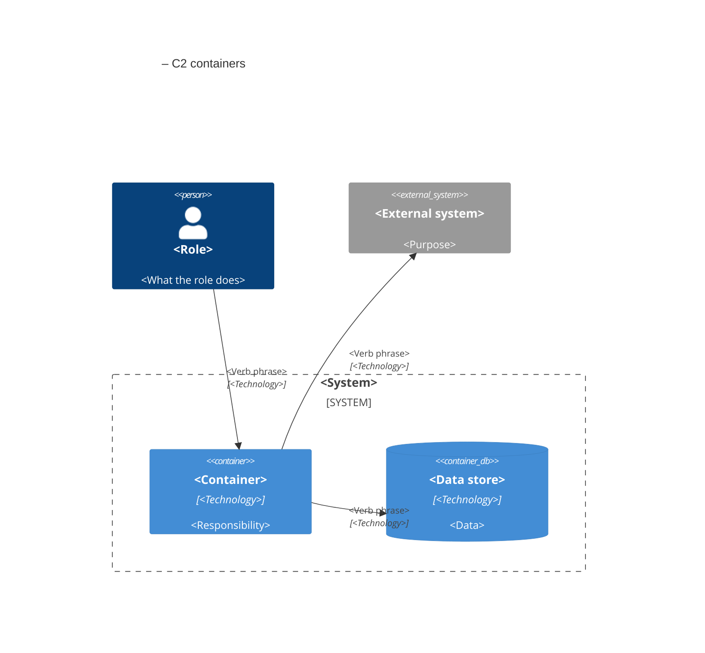

# C2 view template

Keep architecture views as text in `acf-project/architecture/`. Maximum 20 elements in one view.

The C4 model was created by Simon Brown (https://c4model.com). See [Part 2, Chapter 5](../guide/02-shared-meaning.md).

---

Part of the [Agentic Coding Framework](https://github.com/Gabrielx23/agentic-coding-framework) · © 2026 Gabriel Slawski · [CC BY 4.0](https://creativecommons.org/licenses/by/4.0/)
